<!-- Generated by scripts/build.py from scripts/content.json. Edit those, not this file. -->

<a href="https://marianmolnar.cz"></a>

I build custom web and mobile apps, from the interface down to the API, database and deployment. Most of my client work lives in private repos, so below are a few projects that are already live.

<a href="https://marianmolnar.cz">marianmolnar.cz</a> &nbsp;·&nbsp; <a href="https://www.linkedin.com/in/marianmolnar/">LinkedIn</a> &nbsp;·&nbsp; <a href="https://www.instagram.com/marian_m0lnar">Instagram</a>

 

<picture><source media="(prefers-color-scheme: dark)" srcset="assets/heading-work-dark.svg"></picture>

  <a href="https://watchly.marianmolnar.cz"><picture><source media="(prefers-color-scheme: dark)" srcset="assets/work-watchly-dark.svg">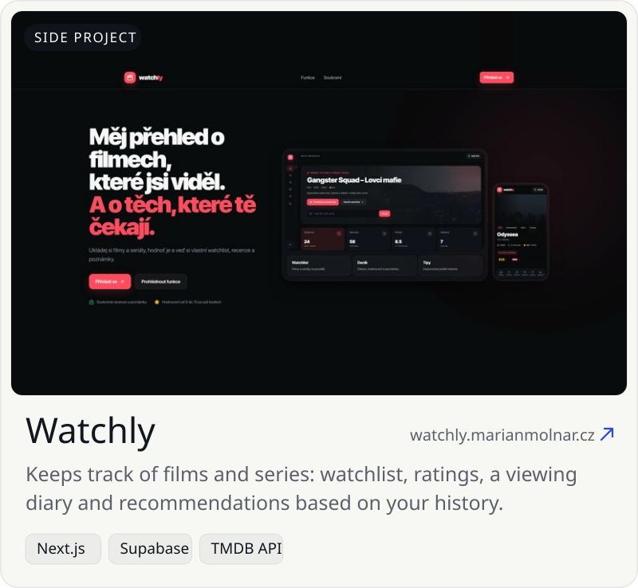</picture></a>
  <a href="https://marianmolnar.github.io/DeadZoneProtocol/"><picture><source media="(prefers-color-scheme: dark)" srcset="assets/work-deadzone-dark.svg">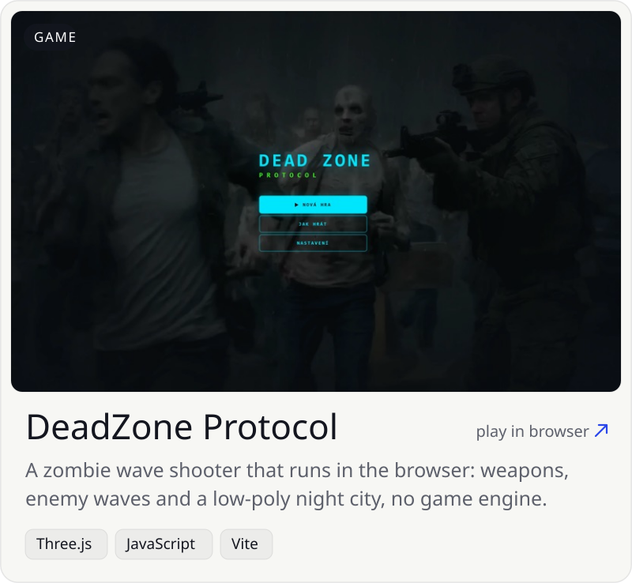</picture></a>

  <a href="https://barberobarbershop.cz/"><picture><source media="(prefers-color-scheme: dark)" srcset="assets/work-barbero-dark.svg">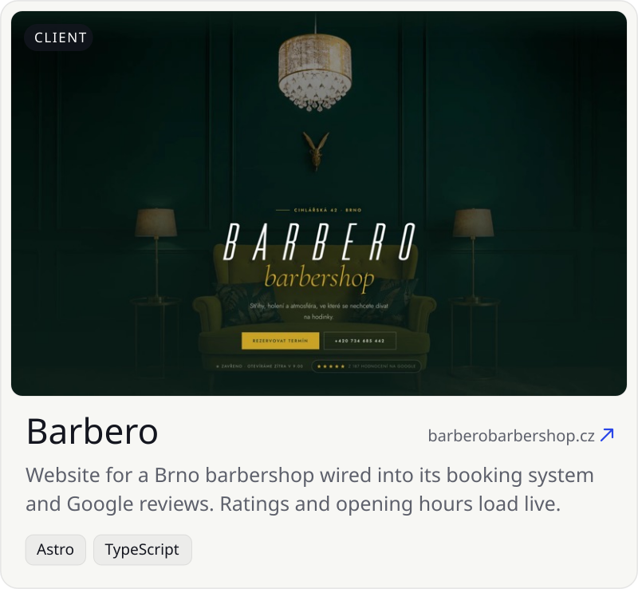</picture></a>
  <a href="https://www.adamhyncica.cz"><picture><source media="(prefers-color-scheme: dark)" srcset="assets/work-hyncica-dark.svg">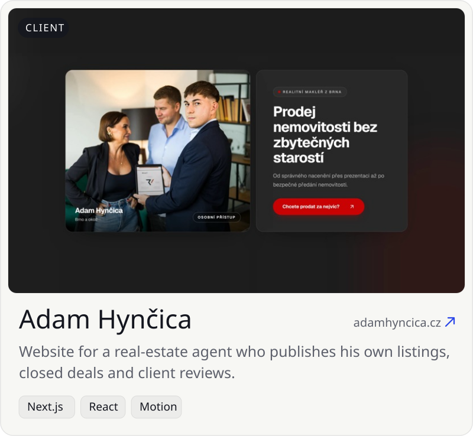</picture></a>

 

<picture><source media="(prefers-color-scheme: dark)" srcset="assets/heading-stack-dark.svg">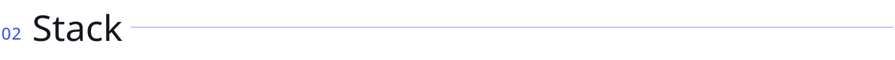</picture>

<picture><source media="(prefers-color-scheme: dark)" srcset="assets/stack-dark.svg">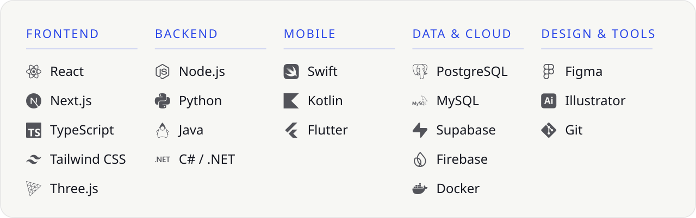</picture>

 

<picture><source media="(prefers-color-scheme: dark)" srcset="assets/heading-oss-dark.svg"></picture>

<a href="https://github.com/marianmolnar/CarFlip"><picture><source media="(prefers-color-scheme: dark)" srcset="assets/oss-carflip-dark.svg">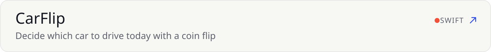</picture></a> 
<a href="https://github.com/marianmolnar/YouTube-Smart-Downloader-with-yt-dlp"><picture><source media="(prefers-color-scheme: dark)" srcset="assets/oss-youtube-smart-downloader-with-yt-dlp-dark.svg">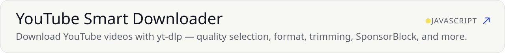</picture></a> 

 

<picture><source media="(prefers-color-scheme: dark)" srcset="assets/heading-activity-dark.svg">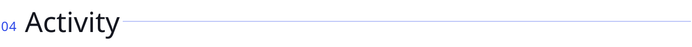</picture>

<picture><source media="(prefers-color-scheme: dark)" srcset="assets/activity-dark.svg">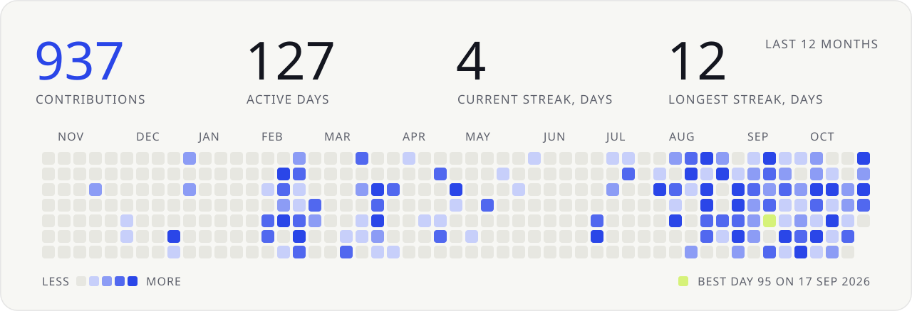</picture>

 

Have a project in mind? <a href="https://marianmolnar.cz/contact"><b>Let's talk →</b></a>

